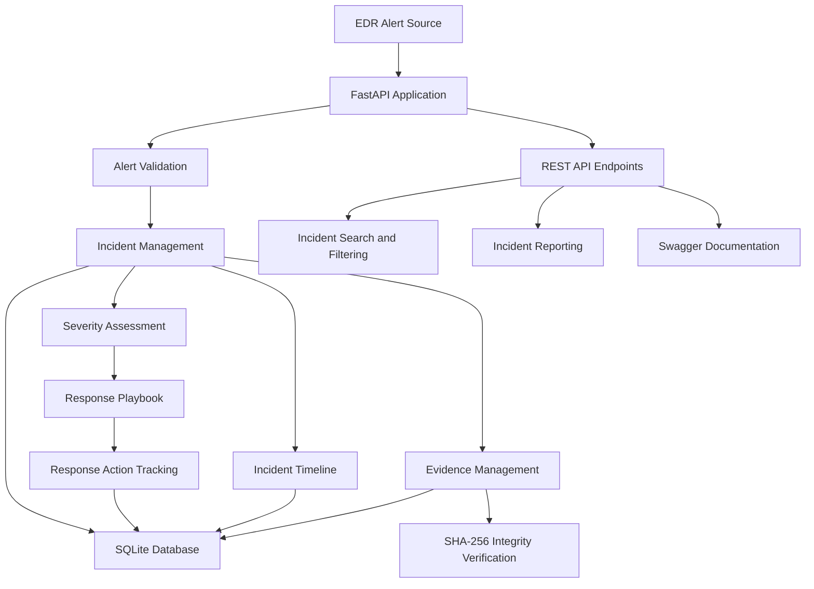
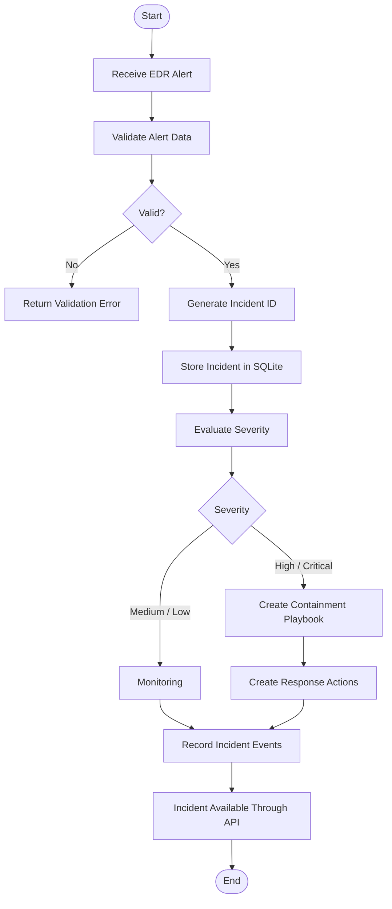
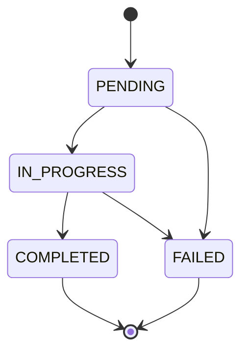
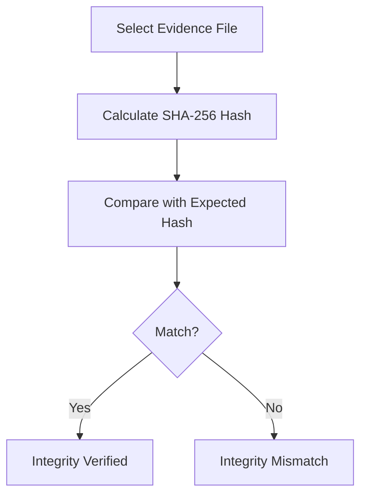
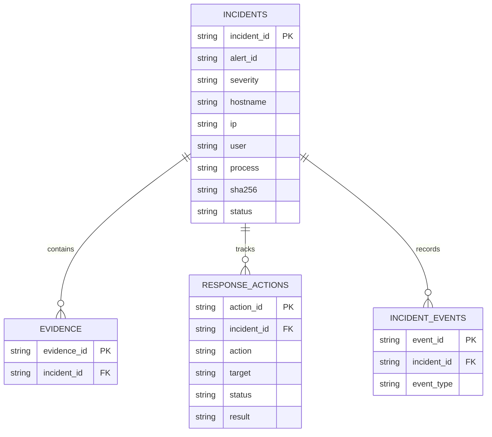

# 🛡️ Ransomware IR Orchestrator

### Automated Ransomware Containment and Incident Response Platform

A Python-based cybersecurity project that demonstrates how security alerts can be converted into structured incidents, how response actions can be tracked, and how digital evidence integrity can be verified.

**Built with:** Python · FastAPI · SQLite · Pydantic · SHA-256 · unittest

---

## 📑 Table of Contents

1. [Project Overview](#-project-overview)
2. [Problem Statement](#-problem-statement)
3. [Project Objectives](#-project-objectives)
4. [System Architecture](#-system-architecture)
5. [How the System Works](#-how-the-system-works)
6. [Incident Response Workflow](#-incident-response-workflow)
7. [Evidence Integrity](#-evidence-integrity)
8. [Incident Timeline and Reporting](#-incident-timeline-and-reporting)
9. [Database Design](#-database-design)
10. [API Documentation](#-api-documentation)
11. [Technology Stack](#-technology-stack)
12. [Project Structure](#-project-structure)
13. [Installation and Setup](#-installation-and-setup)
14. [Running the Application](#-running-the-application)
15. [Testing](#-testing)
16. [Security Considerations and Limitations](#-security-considerations-and-limitations)
17. [Future Improvements](#-future-improvements)
18. [Learning Outcomes](#-learning-outcomes)

---

## 🔍 Project Overview

Ransomware attacks can disrupt systems, encrypt important files, and compromise sensitive information.

During an incident, security teams need to:

* Receive and validate security alerts.
* Identify affected systems.
* Assess incident severity.
* Initiate appropriate response workflows.
* Track response actions.
* Preserve evidence metadata.
* Verify evidence integrity.
* Maintain an incident history.

The **Ransomware IR Orchestrator** demonstrates how these activities can be organized through a centralized REST API.

The application receives simulated Endpoint Detection and Response (EDR) alerts, creates incident records, assigns severity-based response workflows, records evidence metadata, and maintains an incident event history.

It uses SQLite for persistent storage and FastAPI for API development.

This project is developed as a cybersecurity learning, demonstration, and portfolio project.

---

## 🚨 Problem Statement

Traditional incident response can involve multiple disconnected activities.

Security analysts may need to investigate alerts, document incidents, track response actions, and maintain evidence records separately.

This project demonstrates a centralized approach to organizing these activities.

### Proposed Solution

Develop a Python-based incident response orchestrator that:

1. Accepts security alerts through an API.
2. Validates incoming alert information.
3. Creates incident records.
4. Evaluates alert severity.
5. Creates simulated response actions.
6. Tracks action status and incident events.
7. Maintains evidence metadata.
8. Verifies evidence integrity using SHA-256.
9. Provides incident search, filtering, pagination, and reporting.

---

## 🎯 Project Objectives

* Understand Security Orchestration, Automation and Response (SOAR).
* Develop REST APIs using FastAPI.
* Implement severity-based incident handling.
* Store incident information using SQLite.
* Maintain an incident event timeline.
* Track response action status transitions.
* Implement digital evidence integrity verification.
* Develop automated tests.
* Maintain a publicly accessible GitHub project.

---

## 🏗️ System Architecture

The following diagram represents the overall system architecture.



### Main Components

<details>
<summary><strong>1. Alert Ingestion</strong></summary>

Receives security alerts through the EDR webhook.

Incoming alert information includes:

* Alert ID
* Severity
* Hostname
* IP address
* Username
* Process name
* SHA-256 hash

The application validates incoming information before processing it.

</details>

<details>
<summary><strong>2. Incident Management</strong></summary>

Creates and stores incident records.

Each incident receives a unique incident ID.

The application maintains information such as:

* Incident identifier
* Alert identifier
* Severity
* Affected hostname
* IP address
* User
* Process
* Hash
* Incident status

</details>

<details>
<summary><strong>3. Response Playbook</strong></summary>

Selects a response workflow based on alert severity.

* High and critical alerts trigger the ransomware containment playbook.
* Medium and low alerts are assigned to monitoring.

The application records simulated response actions rather than performing real endpoint containment.

</details>

<details>
<summary><strong>4. Evidence Management</strong></summary>

Associates evidence metadata with incidents.

The project also provides SHA-256 integrity verification to detect whether an evidence file differs from the expected hash.

</details>

<details>
<summary><strong>5. Incident Timeline</strong></summary>

Maintains a chronological record of important incident events.

Examples include:

* Incident creation
* Evidence recording
* Response action creation
* Response action status changes

</details>

<details>
<summary><strong>6. Incident Reporting</strong></summary>

Provides an incident report containing relevant incident information and associated response records.

</details>

---

## 🔄 How the System Works

The application follows a sequence of operations whenever an EDR alert is received.



### Severity-Based Response

| Severity | Playbook               | Incident Status   |
| -------- | ---------------------- | ----------------- |
| Critical | RANSOMWARE_CONTAINMENT | RESPONSE_REQUIRED |
| High     | RANSOMWARE_CONTAINMENT | RESPONSE_REQUIRED |
| Medium   | MONITOR                | MONITOR           |
| Low      | MONITOR                | MONITOR           |

---

## 🛡️ Incident Response Workflow

The response action tracking system maintains the progress of individual response actions.

### Response Action Lifecycle



Supported transitions:

| Current Status | Allowed Next Status |
| -------------- | ------------------- |
| PENDING        | IN_PROGRESS         |
| PENDING        | FAILED              |
| IN_PROGRESS    | COMPLETED           |
| IN_PROGRESS    | FAILED              |

COMPLETED and FAILED are terminal states.

---

## 🔐 Evidence Integrity

Digital evidence must be protected from unauthorized modification.

This project implements SHA-256 hashing for evidence integrity verification.

### Verification Process



### Why SHA-256?

SHA-256 is a cryptographic hash function that produces a fixed-length 256-bit digest.

Even a small change in file contents generally results in a different hash.

The project uses this mechanism to help identify modified evidence files.

**Important:** A matching hash confirms that the file matches the supplied expected digest. It does not independently prove the file's origin or establish a complete forensic chain of custody.

---

## 🕒 Incident Timeline and Reporting

The incident timeline provides an event history for an individual incident.

Example event types:

| Event                          | Meaning                          |
| ------------------------------ | -------------------------------- |
| INCIDENT_CREATED               | A new incident was created       |
| EVIDENCE_RECORDED              | Evidence metadata was recorded   |
| RESPONSE_ACTION_CREATED        | A response action was created    |
| RESPONSE_ACTION_STATUS_UPDATED | A response action status changed |

The incident reporting endpoint provides a consolidated view of relevant incident information.

---

## 🗄️ Database Design

The application uses SQLite for persistent storage.

The database is initialized when the FastAPI application starts.

### Database Tables

| Table            | Purpose                                   |
| ---------------- | ----------------------------------------- |
| incidents        | Stores incident information               |
| evidence         | Stores evidence metadata                  |
| response_actions | Stores response action details and status |
| incident_events  | Stores chronological incident events      |

### Database Relationship



The diagram shows the conceptual relationships between the tables.

---

## 🌐 API Documentation

The project exposes REST API endpoints through FastAPI.

### Main Endpoints

| Method | Endpoint                                                | Purpose                         |
| ------ | ------------------------------------------------------- | ------------------------------- |
| GET    | `/`                                                     | Check application status        |
| POST   | `/webhook/edr`                                          | Receive EDR alerts              |
| GET    | `/incidents`                                            | Retrieve incidents              |
| GET    | `/incidents/stats`                                      | Retrieve incident statistics    |
| GET    | `/incidents/{incident_id}`                              | Retrieve an individual incident |
| GET    | `/incidents/{incident_id}/timeline`                     | Retrieve incident event history |
| GET    | `/incidents/{incident_id}/report`                       | Generate an incident report     |
| POST   | `/incidents/{incident_id}/evidence`                     | Record evidence metadata        |
| GET    | `/incidents/{incident_id}/evidence`                     | Retrieve incident evidence      |
| GET    | `/evidence/{evidence_id}`                               | Retrieve an evidence record     |
| POST   | `/evidence/verify-integrity`                            | Verify evidence integrity       |
| GET    | `/incidents/{incident_id}/response-actions`             | Retrieve response actions       |
| PATCH  | `/incidents/{incident_id}/response-actions/{action_id}` | Update response action status   |

### Incident Search and Pagination

The incident listing endpoint supports:

| Parameter | Purpose                                       |
| --------- | --------------------------------------------- |
| severity  | Filter by severity                            |
| status    | Filter by incident status                     |
| hostname  | Search by full or partial hostname            |
| limit     | Maximum number of records (1–100, default 10) |
| offset    | Number of records to skip (default 0)         |

Example request:

```http
GET /incidents?severity=high&limit=5&offset=0
```

Combined filtering is also supported.

### Interactive API Documentation

FastAPI automatically generates Swagger documentation.

After starting the application, visit:

`http://127.0.0.1:8000/docs`

This allows users to explore endpoints and submit API requests.

---

## 💻 Technology Stack

| Technology | Purpose                           |
| ---------- | --------------------------------- |
| Python     | Main programming language         |
| FastAPI    | REST API framework                |
| SQLite     | Persistent database               |
| Pydantic   | Data validation                   |
| Uvicorn    | ASGI server                       |
| SHA-256    | Evidence integrity verification   |
| unittest   | Automated testing                 |
| Ruff       | Code quality and linting          |
| Git        | Version control                   |
| GitHub     | Source code hosting and portfolio |

---

## 📁 Project Structure

```text
Ransomware-IR-Orchestrator/
│
├── app/
│   ├── main.py
│   ├── database.py
│   └── evidence_integrity.py
│
├── tests/
│   ├── test_api.py
│   └── test_evidence_integrity.py
│
├── evidence/
├── alerts/
├── logs/
├── data/
│
├── .gitignore
├── README.md
└── requirements.txt
```

The SQLite database is created locally under `data/incidents.db`.

Virtual environments and local database files should not be committed to the public repository.

---

## ⚙️ Installation and Setup

### Prerequisites

* Python
* Git
* Visual Studio Code or another code editor
* PowerShell or another terminal

### Step 1: Clone the Repository

```powershell
git clone https://github.com/kachwahhakangan/Ransomware-IR-Orchestrator.git
```

### Step 2: Enter the Project Directory

```powershell
cd Ransomware-IR-Orchestrator
```

### Step 3: Create a Virtual Environment

```powershell
python -m venv .venv
```

### Step 4: Install Dependencies

```powershell
.\.venv\Scripts\python.exe -m pip install -r requirements.txt
```

### Step 5: Install Ruff

```powershell
.\.venv\Scripts\python.exe -m pip install ruff
```

---

## ▶️ Running the Application

Start the development server:

```powershell
.\.venv\Scripts\python.exe -m uvicorn app.main:app --host 127.0.0.1 --port 8000
```

Application base address:

`http://127.0.0.1:8000`

Swagger documentation:

`http://127.0.0.1:8000/docs`

---

## 🧪 Testing

Run all automated tests:

```powershell
.\.venv\Scripts\python.exe -m unittest discover -s tests -p "test*.py" -v
```

Run Ruff:

```powershell
.\.venv\Scripts\python.exe -m ruff check app tests --output-format concise
```

Compile application and test files:

```powershell
.\.venv\Scripts\python.exe -m compileall -f app tests
```

### Test Coverage

The test suite covers:

* API root endpoint
* Incident listing and statistics
* Incident search and filtering
* Incident pagination
* Incident reporting
* Incident timeline
* EDR alert validation
* Response action retrieval
* Response action status updates
* Invalid response action transitions
* SHA-256 calculation
* Evidence integrity verification
* Modified and missing evidence files
* Invalid hash formats

---

## 🔒 Security Considerations and Limitations

This project is a cybersecurity learning and demonstration project.

The following limitations are important:

1. Host isolation is simulated; the application does not actually disconnect endpoints.
2. Account suspension is not implemented against Active Directory or cloud identity providers.
3. Memory dumps and forensic artifacts are not automatically collected.
4. Evidence metadata recording is separate from actual forensic acquisition.
5. The development webhook secret must be replaced with secure environment-based configuration.
6. Authentication and role-based authorization require further implementation.
7. The application has not undergone an independent security audit.

Do not connect this demonstration to production systems or perform real containment without implementing and testing the necessary security controls and safeguards.

---

## 🚀 Future Improvements

Potential extensions include:

* Integration with Microsoft Defender for Endpoint.
* Integration with CrowdStrike Falcon.
* Real endpoint isolation through authorized EDR APIs.
* Secure Active Directory account suspension.
* Environment-based secrets management.
* Authentication and role-based authorization.
* Advanced forensic evidence collection.
* Improved chain-of-custody records.
* Structured audit logging.
* Deployment using Docker.
* Production monitoring and alerting.

These are future development goals, not existing implemented features.

---

## 🎓 Learning Outcomes

This project provides practical exposure to:

* Cybersecurity incident response
* Security Orchestration, Automation and Response (SOAR)
* Endpoint Detection and Response (EDR)
* REST API development
* Python programming
* SQLite database management
* Digital evidence integrity
* SHA-256 cryptographic hashing
* Automated testing
* Git and GitHub workflows

---

## 👩‍💻 Project Repository

**GitHub:**
https://github.com/kachwahhakangan/Ransomware-IR-Orchestrator

---

### Disclaimer

This project is intended for educational purposes, cybersecurity learning, and authorized security testing only.
